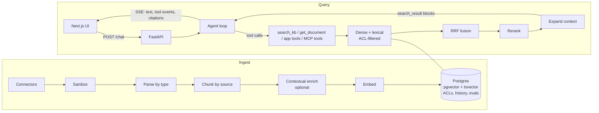

# Hackstack

**A hand-built starter kit for AI agent hackathons.**

Hackstack is the code I bring to day one of an AI hackathon. It provides:

- an agent loop on the Anthropic SDK with pluggable LLM providers;
- hybrid RAG on Postgres + pgvector;
- answers with citations, and search that respects permissions;
- SSE streaming to a Next.js UI;
- evals, tracing and MCP.

Each hackathon becomes a small app on top of the kit, so I spend the event on the idea instead of the plumbing.

It uses no orchestration frameworks. The agent loop, retrieval and provider adapters are a few hundred lines of plain Python that you can read top to bottom and change by hand.

---

## Why hand-built?

Frameworks are great until you need to explain, debug or bend them at 3 a.m. Hackstack takes the opposite approach:

- **Own the core.** The tool-use loop, hybrid search, rank fusion and citation handling are written directly against the APIs. Nothing is hidden: no extra LLM calls, no abstraction you can't step through.
- **Buy the bricks.** Parsing, embeddings, reranking, the database driver and source SDKs are ordinary libraries behind small interfaces.
- **Swap by config.** Every component is chosen by name in `hackstack.yaml`. Changing the embedder, the store or the LLM provider means a config change plus, at most, one new file.
- **Learn as you go.** Every component has a doc explaining how it works inside, its settings and their defaults, how to swap it, and how it fails.

## Features

- **Agent loop**: a manual Claude tool-use loop with parallel tool calls, handling for every stop reason, an iteration cap and prompt caching.
- **Agent or single-shot mode**: switch per request. Single-shot is the fast path and the baseline for evals.
- **Pluggable providers**:
  - A native Anthropic adapter, which keeps built-in citations and prompt caching.
  - An OpenAI-compatible adapter for OpenAI, Ollama, vLLM, Groq and OpenRouter.
- **Hybrid retrieval**: dense vectors and full-text search in one Postgres database, fused with Reciprocal Rank Fusion. The reranker is optional, and a no-op version is included.
- **Grounded answers**: Anthropic `search_result` blocks give citations the API guarantees point to real sources. Answers with no citations get a low-grounding flag.
- **Permission-aware search**: the access list is copied onto every chunk and filtered inside SQL for both retrievers. Search fails closed: if access is unknown, nothing is shown.
- **Connectors**:
  - Local files (PDF, Markdown, DOCX, HTML)
  - GitHub
  - Notion
  - Slack
  - Google Drive
  - Gmail
- **Ingestion**:
  - The parser is chosen by file type: MarkItDown for Office and HTML, Docling for PDFs (optional).
  - Chunking follows the source's structure: headings, Slack threads, emails, code symbols.
  - Optional contextual retrieval, following Anthropic's recipe.
- **Incremental sync**: unchanged content is skipped, and per-source change cursors and deletion checks keep the index current.
- **Streaming UI**: a Next.js chat with clickable citations, a live panel showing each search and its results, a user switcher and a mode toggle.
- **Evals**: hand-written retrieval metrics (recall@k, MRR, nDCG), synthetic golden-set generation, pass/fail LLM judges, and a regression baseline.
- **Tracing**: OpenTelemetry spans for every stage, with optional Arize Phoenix.
- **MCP**:
  - Hackstack is an MCP server, so Claude Desktop and Claude Code can search the knowledge base.
  - It can also use tools from external MCP servers.
- **Local mode**: runs fully on Ollama with no paid APIs.
- **Offline tests**: fake LLM and embedding models, so `make test` needs no API keys.

## Architecture



**How a question flows:**

1. The UI posts the message along with the active user.
2. The server rebuilds the conversation from Postgres and works out which access groups that user belongs to.
3. Claude is called with a small set of tools. It writes its own search queries, often several in parallel.
4. Each search runs dense and full-text retrieval under the same permission filter, fuses the two rankings, and reranks them.
5. Results go back to Claude as `search_result` blocks.
6. The answer streams to the browser with citations attached. Every tool call shows up live in the sources panel.

## Stack

| Layer | Default | Alternatives |
|---|---|---|
| API | Python 3.11+, FastAPI, SSE | Streamlit client for a quick UI |
| LLM | Claude via the `anthropic` SDK: Sonnet 5.5 for answers, Haiku 5.5 for helper tasks | Any OpenAI-compatible endpoint, including Ollama |
| Embeddings | Voyage `voyage-4`, 1024 dimensions | `qwen3-embedding:0.6b` via Ollama |
| Store | Postgres 17 + pgvector (HNSW) + `tsvector` | Qdrant and LanceDB, planned |
| Reranker | Voyage `rerank-3` | Local cross-encoder, or the no-op reranker |
| Parsing | MarkItDown, plus Docling for PDFs | pypdf as a lightweight fallback |
| Frontend | Next.js (App Router), TypeScript, Tailwind | — |
| Tracing | OpenTelemetry + Arize Phoenix | Langfuse |
| Tooling | uv, ruff, pytest, Docker Compose | — |

## Quickstart

**Prerequisites:** Python 3.11+, [uv](https://docs.astral.sh/uv/), Node 20+, Docker.

```bash
git clone https://github.com/<you>/hackstack.git && cd hackstack
cp .env.example .env          # add ANTHROPIC_API_KEY and VOYAGE_API_KEY
make setup                    # Python + web dependencies
make up                       # Postgres (add --profile tracing for Phoenix)
make ingest-sample            # index the demo company in apps/company_brain
make dev                      # API on :8000, web on :3000
```

Open http://localhost:3000. Pick a user and ask a question, then switch users and ask it again.

**No API keys?** Run fully locally with Ollama:

```bash
ollama pull qwen3-embedding:0.6b && ollama pull <chat-model>
HACKSTACK_PROFILE=local make ingest-sample && HACKSTACK_PROFILE=local make dev
```

**From the terminal:**

```bash
uv run hackstack ask "What is the PTO carryover policy?" --as finance@northwind.test
```

### Make targets

| Command | What it does |
|---|---|
| `make setup` | Install Python (uv) and web (npm) dependencies |
| `make up` / `make down` | Start or stop Postgres (and Phoenix with the tracing profile) |
| `make ingest-sample` | Ingest the active app's sample corpus |
| `make dev` | Run the API and web UI with hot reload |
| `make test` | Unit and integration tests; offline, no keys needed |
| `make eval` | Generate or run the golden set and compare retrieval configs |
| `make mcp` | Start the MCP server over stdio |
| `make reset` | Drop and recreate the index (needed after changing the embedder) |

## Configuration

- **`hackstack.yaml`**: non-secret settings, such as which components to use, the active app, the profiles, and the tuning knobs.
- **`.env`**: secrets only, such as API keys and connector tokens. See `.env.example` for every variable.
- **`apps/<app>/users.yaml`**: demo users and their groups, used for permission-aware answers.

The settings you'll touch most:

| Setting | Default | Turn it when |
|---|---|---|
| `chunk.size` / `chunk.overlap` | 400 / 0–50 tokens | Recall drops on long sections. Tune with `make eval` |
| `enrich.contextual` | `false` | The corpus is fairly static and you want better recall |
| `embed.model` / `embed.dim` | `voyage-4` / 1024 | Going local. Then run `make reset` and re-ingest |
| `retrieval.window` | 50 per retriever | You need more candidates for the reranker |
| `rrf.k` | 60 | Lower it to favour top-1 precision |
| `rerank.top_n` | 8 | Answers lack context, or cost too much |
| `agent.max_iterations` | 6 | Cost guard for the tool loop |
| `llm.answer_model` | `claude-sonnet-5-5` | Use `claude-opus-5-5` for hard reasoning |

## Building a hackathon app

The kit stays generic. Everything specific to one event lives in `apps/<name>/`:

```
apps/company_brain/
  app.yaml          # system prompt, enabled tools, connectors, UI title
  prompts/system.md
  tools.py          # app-specific agent tools (e.g. find_experts, whats_changed)
  users.yaml        # demo personas and groups
  sample_corpus/    # demo data
  demo-script.md    # the 90-second pitch and demo questions
```

To start a new event:

1. `cp -r apps/_template apps/<idea>`.
2. Set `app: <idea>` in `hackstack.yaml`.
3. Write the system prompt.
4. Add one or two tools.
5. Ingest some data and start iterating.

`apps/company_brain` is the reference app. It is a "company brain" agent for a fictional company, Northwind Labs, with:

- permission-aware answers that change by role;
- "who should I ask about X?";
- "what changed since Monday?";
- flags when sources conflict.

## Project layout

```
hackstack/
  config.py  models.py  registry.py  cli.py  tracing.py
  connectors/   parsing/   chunking/   enrich/   embed/   store/
  retrieval/    llm/       agent/      sync/     api/
  mcp_server.py  mcp_client.py
apps/           # one folder per hackathon app
evals/          # golden sets, metrics, judges, baselines
web/            # Next.js UI
tests/          # offline tests with fake LLM and embedding models
docs/           # architecture, per-component deep dives, recipes
```

Core interfaces (each one is a seam where a component can be swapped):

```python
Connector.load_all() -> Iterator[RawDoc]           # + optional poll(since), list_ids()
Parser.parse(content, mime) -> ParsedDoc
Chunker.chunk(doc, raw) -> list[Chunk]
Embedder.embed_documents(texts) / embed_query(text)
Store.upsert / delete_doc / dense(...) / lexical(...)
Reranker.rerank(query, hits, top_n)
LLMProvider.stream(system, messages, tools) -> AsyncIterator[LLMEvent]
```

## Extending

Full recipes are in [`docs/extending.md`](docs/extending.md).

- **Add a connector:**
  1. Create `hackstack/connectors/<name>.py`.
  2. Decorate it with `@register("<name>")`.
  3. Yield `RawDoc`s with an access list.
  4. Enable it in config.
- **Swap the embedder:**
  1. Implement `Embedder`.
  2. Set `embed.model`.
  3. Run `make reset` and re-ingest. Mixing vectors from different models is refused on purpose.
- **Add an agent tool:** write a function with a clear, multi-sentence description in your app's `tools.py`, then list it in `app.yaml`.
- **Add a store:** implement `Store`, including the permission filter on both `dense` and `lexical`.

## Evals

```bash
make eval
```

1. Generate a synthetic golden set from your corpus: one question per sampled chunk, plus tricky lookalike questions and questions the corpus can't answer.
2. Compare retrieval setups: dense only, hybrid, hybrid with reranking, and with or without contextual retrieval. Results are scored with recall@k, MRR and nDCG.
3. Optionally run the pass/fail LLM judges for faithfulness and relevance.

Results are saved with a hash of the config, and a regression test fails if recall@5 drops below the committed baseline. Synthetic questions reuse the source chunk's wording, which flatters full-text search, so treat the absolute numbers with care and focus on how configs compare.

## MCP

**As a server.** This lets Claude Desktop and Claude Code search your knowledge base. Add this to Claude Desktop's config:

```json
{
  "mcpServers": {
    "hackstack": {
      "command": "uv",
      "args": ["--directory", "/path/to/hackstack", "run", "python", "-m", "hackstack.mcp_server"],
      "env": { "HACKSTACK_AS_USER": "you@company.test" }
    }
  }
}
```

**As a client.** List external MCP servers in `hackstack.yaml`. Their tools are registered under prefixed names, such as `github__search_issues`.

## Learn the internals

Every component has a deep dive in `docs/components/`, covering:

- what it does and why it exists;
- how it works internally;
- the code path in reading order;
- its settings;
- how to swap it;
- how it fails;
- hands-on exercises.

Start with [`docs/architecture.md`](docs/architecture.md), then read `agent/loop.py` and `retrieval/hybrid.py`. They are the heart of the kit.

[`docs/frameworks.md`](docs/frameworks.md) shows the same agent written in Pydantic AI and compares what each version hides.

## Using this at a hackathon

Many hackathons only judge work done during the event. Hackstack is pre-existing work, and [`PRIOR_WORK.md`](PRIOR_WORK.md) lists exactly what was built beforehand, so you can disclose it to the organizers. Check the rules before you start. A clean split is to present the kit as infrastructure and the app in `apps/<idea>/` as the event build.

Before the event:

- Set up every credential. Google OAuth is the slowest.
- Pre-pull the Docker images and models.
- Script the demo.
- Record a backup video.

## Roadmap

- [ ] Qdrant and LanceDB store adapters
- [ ] Permission sync for nested Drive and Notion permissions
- [ ] Hosted deployment guide (Neon + Render/Railway, or a VPS with Compose)
- [ ] Judge calibration against human labels
- [ ] Error-analysis UI for tagging failed traces

## Acknowledgements

- Contextual retrieval follows Anthropic's [Contextual Retrieval](https://www.anthropic.com/news/contextual-retrieval) recipe.
- The connector design is adapted from [Onyx](https://github.com/onyx-dot-app/onyx).
- Reciprocal Rank Fusion is from Cormack, Clarke & Büttcher, SIGIR 2009.

## License

MIT
