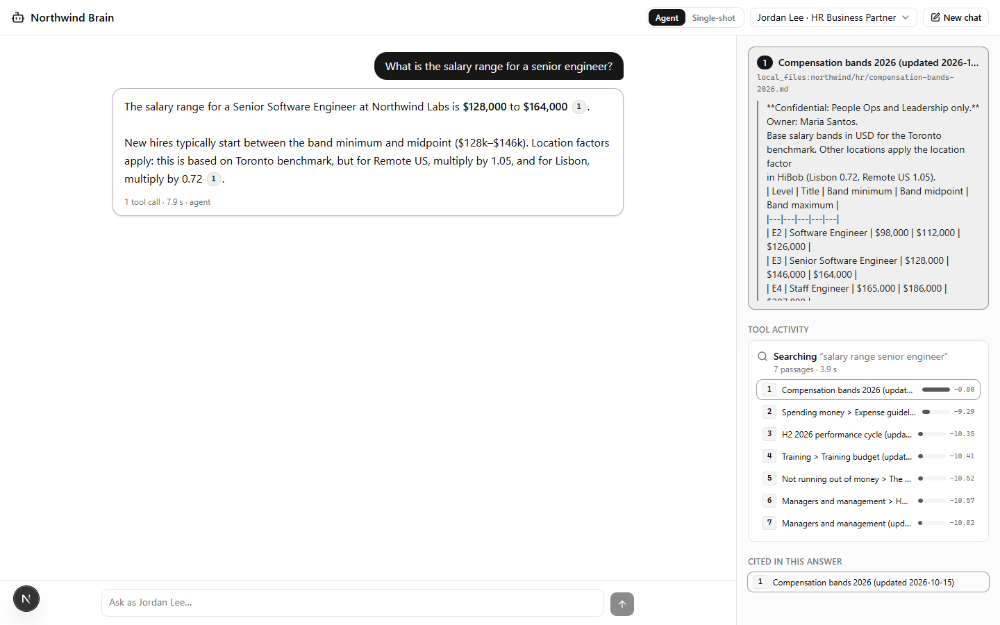

# Hackstack web UI

A Next.js (App Router, TypeScript, Tailwind, shadcn/ui) chat client for the hackstack API. It talks to `POST /chat` over the kit's own SSE vocabulary ([`docs/sse.md`](../docs/sse.md)) with a hand-rolled `fetch` + `ReadableStream` reader. It uses no AI SDK.



## Run it

From the repo root:

```sh
make setup                     # once: Python deps + npm install in web/
HACKSTACK_PROFILE=local make dev   # API on :8000 and this UI on http://localhost:3000
```

Open **http://localhost:3000**. Use `localhost`, not `127.0.0.1`, unless you add `127.0.0.1:3000` to `api.cors_origins`; the default config allows both. To point the UI at another API, set `NEXT_PUBLIC_API_URL`, for example `NEXT_PUBLIC_API_URL=http://127.0.0.1:8010 npm run dev`.

## What's on screen

| Feature | How it works |
|---|---|
| **Streaming answer** | `text_delta` events are appended as they arrive. Text sent before a tool call is shown as a muted preamble, and `done.answer` replaces the draft at the end. |
| **Clickable citations** | `[n]` and `[n, m]` markers become chips. Clicking one opens passage *n* in the sources panel, with the quoted text the answer cited. |
| **Sources panel** | Driven by `tool_start` and `tool_end`. It shows each search's query, its passages with their citation numbers and retrieval scores, and timing, live during streaming. Once the turn ends, it lists the passages the answer cited. |
| **User switcher** | Users come from `GET /users`. A conversation belongs to its user, so **switching user starts a new conversation**. The last question stays in the composer, so you can ask it again and get the other user's answer. |
| **Mode toggle** | Agent (tool loop) or single-shot (retrieve once, one call). It applies to the next question. |
| **Low-grounding badge** | Shown when `grounding.low_grounding` is true, meaning the answer cited nothing. |
| **Errors** | An `error` event, or a non-200 response, shows the message and a **Retry** button. The server stores nothing for a failed turn. |

## Code map

| Path | What |
|---|---|
| `lib/sse.ts` | SSE frame reader: an async generator over a response body. |
| `lib/turn.ts` | A pure reducer that folds `/chat` events into one turn's state. |
| `lib/citations.ts`, `lib/inline.ts` | Split answer text into `[n]` markers and minimal inline Markdown: bold, code and links. No HTML is ever interpreted. |
| `lib/api.ts`, `lib/types.ts` | API client and event types. |
| `components/chat.tsx` | The page: header, turns, composer and state. |
| `components/sources-panel.tsx`, `components/answer.tsx` | The sources panel, and the answer with its citation chips. |
| `components/ui/*` | shadcn/ui primitives (base-ui). |

## Checks

`make test-web` runs `npm test` (vitest, offline, under 1 s), then `npm run lint` and `npm run typecheck`. `npm run build` does the production build. These are kept out of `make test`, which stays Python-only, so a fresh clone without `npm install` still passes it.

## Notes

- **Fonts:** the UI uses system fonts with no `next/font/google`, so builds don't need network access.
- **Node 20.9 to 20.18:** `package.json` overrides `magic-string` to 0.30 for `@tailwindcss/node`. Version 1.x of `magic-string` is ESM-only and can't be `require()`d before Node 20.19. On newer Node the override is harmless.
